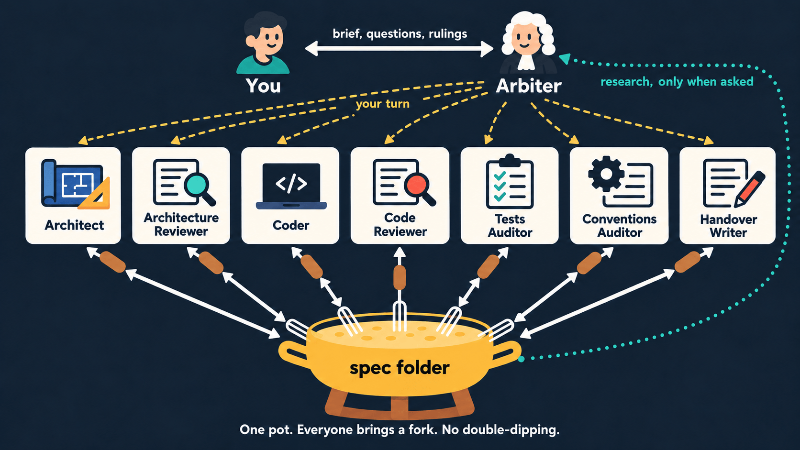
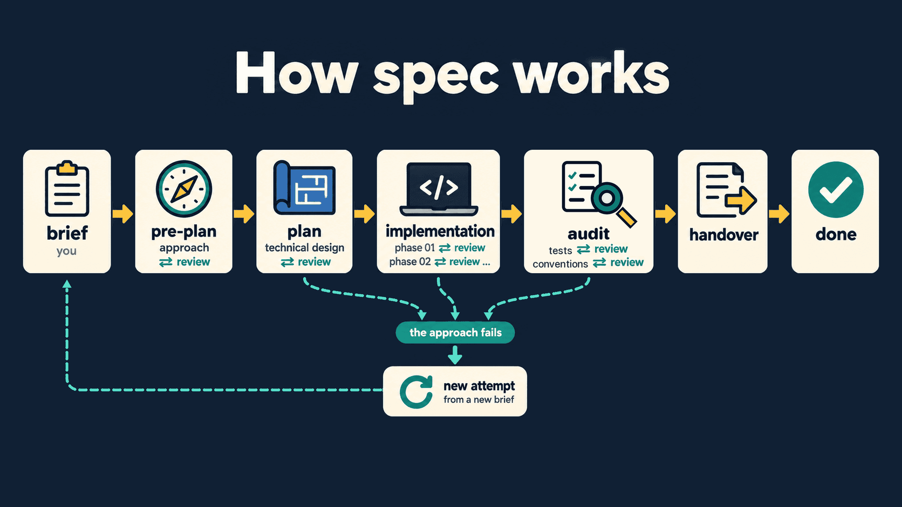
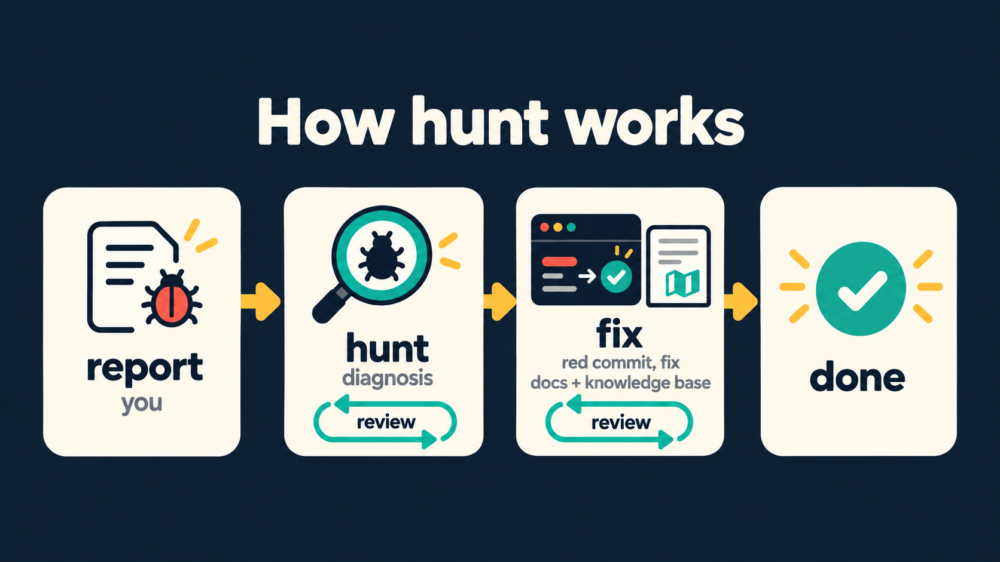

<meta name="google-site-verification" content="MTz4heRcrDBp_OJvJCdytZcC2XKKcgvnuiYfBX3NW7w" />
<h1 align="center">🫕 fondue</h1>

<p align="center">
  <i>One pot. Everyone brings a fork. No double-dipping.</i><br><br>
  <b>A team of AI agents that plan, build and review each other's work, with you as the team lead.</b><br>
  Spec-driven development and bug hunting for Claude Code.
</p>

<p align="center">
  
  
  
</p>

Coding with AI is easy to start and hard to get right. fondue makes it easier by giving you a
team: agents that plan, build and review each other's work until it holds up. It's about
**quality**, and **you're the team lead**. You set the goal, pick the team, and have the final
word. Give it a try :)

Why fondue? One shared pot, and everyone brings their own fork. The spec folder is the pot, and
every role dips in with a session of its own, on whichever agent you seat. And one house rule:
**no double-dipping.** Nobody reviews their own work.

<p align="center">
  
</p>

> ⭐ Hey! This fondue is free, and so is a GitHub star ;) You're one click away from making my day!

## 🚀 Quick start

```
/plugin marketplace add jsobolewski1/fondue
/plugin install fondue@fondue
```

1. **Restart Claude Code.** Agent types load at session start.
2. **Open your project** and run `/fondue:spec`. The Arbiter walks you through the start, a few
   questions at a time: the title, the team role by role, the skills each role loads, and
   `Sessions: fresh` or `continue`.
   Anything your command already says, it doesn't ask.
3. **Draft the brief** your way: write it yourself, let the Arbiter interview you, draft it from your
   notes, or have it research the code first. Sign it off, and lead the team from there.

For a bug, use `/fondue:hunt` instead. To give every role a map of your codebase first, run
`/fondue:kb-init` once (see Knowledge base below). To try a local checkout without installing:
`claude --plugin-dir /path/to/fondue`.

## ✨ What makes it different

Spec-driven tools mostly agree on the stages: spec, plan, tasks, code. **fondue is about what
happens between them.**

- 👥 **Every role is its own session, on any vendor.** Architect, reviewer, coder: each is a separate
  session, and each can run on Claude, Codex, or any agent you can drive from a shell.
- 🧭 **The reviewer designs before reading.** They write down how *they* would build it before
  opening the draft, so they question the frame, not just its details.
- 🛡️ **Guarantees get attacked before any code exists.** The approach states its **invariants**:
  what it guarantees, and under which conditions. The reviewer tries to break each one with a
  concrete scenario: a hostile caller, a load spike, a slow dependency. A broken invariant blocks
  the draft, even when the flaw hides in a detail that would otherwise wait for the plan.
- 🧬 **Tests that can actually fail.** After the last phase, an auditor mutates everything the spec
  changed and adds a test for every mutant that survived. A second auditor brings the code in line
  with your project's rules. Each writes its own changes, and a fresh Coder checks them by running
  them.
- 🔍 **Evidence, or it isn't a finding.** Every finding carries a `file:line` or a command and its
  output. Claims about libraries and tools are **run, not read**.
- ⚖️ **A neutral Arbiter.** The session you talk to runs the process and never rules on the work, so
  no author writes the prompt for its own reviewer. It reads the work only when you ask, and what it
  finds reaches the team only through your rulings. Once every review has closed, it writes any handover document you ask for.
- 🗺️ **Reshape before you add.** Before designing, the Architect lists what the code already has
  for each part of the goal, and whether the plan reuses it, reshapes it or adds something new.
  "New" needs a reason. A **knowledge base** of your modules makes that search cheap, and every spec
  keeps it current.
- 🔁 **Plans are allowed to fail.** A broken approach reopens as a new attempt, which must show that
  it doesn't rest on the assumption that broke.
- 📊 **Every turn's cost is on the record.** Tokens and minutes, per turn and per role.
- 🐞 **Bugs get their own protocol.** Rival causes are ruled out by experiment, then a **red commit**
  proves the fix.

## 🧪 Status

fondue is young. Here's what it has actually run:

| | |
|---|---|
| ✅ **spec** | 30+ specs done across several projects, from small features to a 500-file refactoring |
| ✅ **hunt** | 10+ bugs to a verified fix |
| ✅ **Mixed vendors** | Codex has held the Architecture Reviewer seat in real specs, through an earlier setup |
| ✅ **First-run agent setup** | Dry-run against Codex |
| ✅ **Knowledge base** | Piloted on a 33-module Java project, then on a C project, a shell project, a Vue/JavaScript web part, a public TypeScript project and fondue itself; not yet run inside a spec |
| 🆕 **Invariants and the audit** | New in 0.7, shaped by a run of five specs on one hard fix; not yet run inside a spec |

Earlier specs ran on earlier versions of the protocol. **Issues and war stories are welcome.**

## 📋 Requirements

- **Claude Code** with the `SendMessage` tool. The Arbiter uses it to send each role its next turn,
  so a permission rule that denies it breaks the process. Tested on v2.1.284.
- **git** and **Python 3**. Python runs the per-turn stats scripts and the knowledge base's tooling.
- **The `claude` CLI** on the `PATH`, for the knowledge base: each card is one `claude -p` call.
- **Optional:** the command-line tool of any other agent you want in the team, installed and signed
  in, e.g. OpenAI's `codex`.
- **Optional:** a mutation-testing tool for your language, e.g. PIT for Java. The Tests Auditor uses
  it when your project has one, and mutates by hand when it doesn't.

## 🏗️ How spec works

<p align="center">
  
</p>

| Role | What they do | Lives for |
|---|---|---|
| **You** | Write the brief, pick the team, rule on disagreements and questions | the whole spec |
| **Arbiter** | Spawns roles, sends turns, keeps state, researches for you on request, writes any further handover document. Never rules on the work | the whole spec |
| **Architect** | Researches, drafts the approach, then the technical plan | one attempt |
| **Architecture Reviewer** | Reviews both, after designing their own approach first. A new one reviews the handover update | one attempt |
| **Coder** | Implements one phase, leaving the build green on every turn. In the audit, reviews the auditors' changes and fixes what they may not change | one phase, or all of them with `Sessions: continue`; one audit topic |
| **Code Reviewer** | Checks the change against the plan and your project's rules on structure | as long as the Coder |
| **Tests Auditor** | After the last phase, mutates the spec's code and adds a test for each mutant no test caught. Changes tests only; a new Coder reviews | its audit topic |
| **Conventions Auditor** | Then brings the spec's code in line with your project's rules, without changing behaviour; a new Coder reviews | its audit topic |
| **Handover Writer** | Brings the knowledge base and your project skills up to date with what the spec changed | handover |

- **Two planning stages.** *Pre-plan* settles the **approach**: the decisions that shape it, the
  alternatives rejected, the **invariants** it guarantees, and the phases with their gates. *Plan*
  settles the **technical decisions** and tasks, each with how it is tested. If the approach is
  rejected, only a short draft is thrown away, never a set of detailed phase files.
- **Invariants are attacked, not just read.** The reviewer writes their own invariants before
  opening the draft, then tries to break the draft's with concrete scenarios. An invariant a
  scenario breaks blocks the draft, and the fix must keep it: dropping the decision or narrowing
  the invariant doesn't count. A guarantee you didn't ask for comes to you as a question.
- **Fresh sessions per phase.** Each phase gets a new Coder and a new Code Reviewer, so no session
  drags a long history along. For a spec with small phases, `Sessions: continue` in the roster keeps
  the pair through every phase instead. It's an experiment, and `protocol/stats-total.py` gives each
  spec one figure to compare.
- **The audit checks the whole range.** After the last phase, two auditors read everything the spec
  changed. The Tests Auditor mutates it and adds a test for each mutant no test caught; the
  Conventions Auditor fixes what breaks your project's rules. Each makes its own changes, and a new
  Coder reviews them, re-running mutants where it doubts a claim. What an auditor may not change,
  such as a bug in production code, goes to a Coder and a Code Reviewer, as a phase does.
- **Handover updates the docs.** After the audit, the Handover Writer rewrites the knowledge
  base cards and the project skills that the spec made wrong, and a reviewer checks them against the
  code. Docs that steer every later spec don't get to drift.
- **Reopening.** If the approach breaks in plan, in implementation or in the audit, the failed
  attempt is set aside, and you sign a new brief. A fresh Architect and Reviewer then read **what
  the old plan was and what broke it**. Work already committed is kept, amended or reverted, phase
  by phase.
- **Abandoning.** A spec that won't deliver can be stopped, and its archive says so.

## 🐞 How hunt works

Use it for a bug whose cause is **unknown and takes experiments to find**: intermittent,
distributed, load-dependent. A bug with a stack trace and an obvious fix doesn't need it.

<p align="center">
  
</p>

- 🕵️ **Hunter:** reproduces, localizes and root-causes the bug. Every step of the chain stands on
  something that was **run, not read**.
- 🧐 **Reviewer:** asks **what else fits the evidence**. A rival cause the diagnosis hasn't ruled
  out is a Blocker, whether the Hunter thought of it or not.
- 🔴 **Red commit first:** the regression check alone, failing for the diagnosed reason. The fix
  then turns it green.
- 📈 **Rate-based bugs:** the run after the fix must be big enough that the old rate would have
  produced **at least 5 failures**, and it must show none.

## 🗺️ Knowledge base

AI sessions on a big codebase fail in familiar ways: they rebuild what exists under another name,
and treat existing code as untouchable and build around it. The knowledge base is a map that roles
read before they design:

- `fondue/kb/index.md`: one entry per module, saying what it offers, with other names for the same
  thing, plus every project skill. Small enough to read whole, about 5k tokens for 30-40 modules.
- `fondue/kb/cards/<module>.md`: what a module offers, **where a new thing plugs in** (down to the
  file that wires it), and what not to rebuild. What and where only. Why and how stay in your skills.
  A module too broad for one card can get a card per directory, listed in `fondue/kb/parts.txt`,
  without changing your build. The same file can leave out what isn't source, or add a language
  the tool doesn't list.

`/fondue:kb-init` builds it. A script does all the crawling: declarations without method bodies,
the places other modules construct a module's types or mention its names, wiring and manifest files.
The model then writes each card in **one call with no tools**, so no agent wanders the code with a
growing context. On a 33-module Java project, every card together cost about **$1.7 on Sonnet**; 35
cards over five projects in other languages cost $2.09, about $0.06 a card. The skill shows you its
estimate before spending anything. After that, each spec's handover and each hunt's fix update the
cards they touched. `kb.py status` checks every card against the code for free.

It reads any project: Maven and Gradle modules as their build lays them out, and every other
directory of source as a module of its own. Java and `.proto` have their own readers, and every other
language goes through one that keeps declarations by indentation. The why behind it is in
[`skills/kb-init/design-notes.md`](skills/kb-init/design-notes.md).

## ⚖️ The rules every review follows

Both skills run on one engine, [`protocol/engine.md`](protocol/engine.md):

- **Nothing is accepted on its author's word.** Claims about a library, a build plugin or a test
  runner are run, and the output is recorded. Docs don't count.
- **Every finding has an anchor:** a `file:line`, a command and its output, or the spec line it
  contradicts.
- **"It doesn't exist" must be shown failing.** An empty search only shows where you didn't look.
- **Fixed verdicts.** A fix the reviewer can state exactly is approved unseen, which saves a round.
- **Deadlocks and questions come to you.** A deadlock gives you both positions side by side. A decision
  that is yours (scope, or a change to an approved plan both sides agree on) comes to you as a question
  the first time it appears, not rounds later, with its options and what each one means. Both are written
  for you to rule on without opening a file, and the Arbiter quotes them unchanged. Ask for advisors on
  other models if you want a second opinion. Your ruling is **binding**.
- **Agents share nothing but files.** A message says only whose turn it is.

<details>
<summary><b>See a real Blocker</b> (trimmed, project names replaced)</summary>

```
## #1 The cluster socket binds every interface by default, and on every host a dev run lands on

**Severity:** Blocker

`ClusterFactory.create(...)` binds the cluster socket at `new InetSocketAddress(
properties.getBindAddress(), cluster.getPort())`, and `app.bind-address` defaults to `0.0.0.0`
(`application.yml:9`, `ServerProperties.java:21`). `application-dev.yml` does not narrow it. [...]
The phase text forbids this: "do not bind it to a publicly reachable interface in any test or
default beyond what the deployment needs" (phase-02.md, Essential knowledge 9).

**Proposed solution:** add `app.cluster.bind-address`. [...]
```

</details>

## 🤖 Agents and models

- **Default team:** every role on **Opus**, except the Architect on **Fable**, all at effort `high`.
  The reasons, observed on real runs, are in
  [`design-notes.md`](skills/spec/design-notes.md). A cheaper Arbiter or Coder looked like a
  saving and wasn't.
- **Mix vendors.** Any role can run on another agent. A model is a worse reviewer of its own blind
  spots than of someone else's.
- **First-run setup.** The first time you start a spec, the Arbiter **finds the agents on your
  machine**, sets up the ones you pick, and checks that each can keep a session across turns.
  Adapters live in `~/.config/fondue/integrations/agents/`.
- **Bring your own fork.** A **Codex** adapter ships with the plugin. The contract for writing your
  own is in [`integrations/agents/contract.md`](integrations/agents/contract.md).
- **Bring your own rules.** Your coding rules and project skills aren't part of fondue. Name them
  per role, and every role loads them.

## 📁 The spec folder (the pot)

Everything is **plain files in your repository**, which you can read, diff and review:

```
fondue/specs/022-<name>/        (a real spec, at done, with the audit 0.7 adds)
  roster.md  99-user.md  stats.md  current-state.txt  landed.md
  pre-plan/  00-brief.md  01-research.md  02-reviewer-research.md  03-draft.md … 05-draft.md
  plan/      plan.md  research.md  phase-01.md … phase-07.md
  audit/     findings.md                    (only when an auditor found what it may not change)
  review/    pre-plan/  plan/  phase-01/ … phase-07/  audit-tests/  audit-conventions/
             00-request.md  01-review.md  02-answer.md …
  handover/
```

- Bugs live in `fondue/bugs/<bug>/`, and the knowledge base in `fondue/kb/`.
- Finished work is archived under `fondue/specs/archive/` and `fondue/bugs/archive/`.
- **Don't want it in git?** Ignore `fondue/`. The process detects that and skips its own commits.

## 💰 Cost: good cheese isn't cheap

**This is not a cheap way to write code.** Use it where a wrong design or a wrong diagnosis would
cost more than the tokens. For a small, obvious change, just make the change.

Two real specs, the 022 above and the one before it:

| Spec | Phases | Turns | Agent time | Claude | Claude, input-equivalent | Codex |
|---|---|---|---|---|---|---|
| 021 | 3, after one reopen | 31 | 3.0 h | 0.17M output · 1.8M cache writes · 111M cache reads | 15.6M | 27.9M input, 26.5M of it cached · 128k output (both reviewers) |
| 022 | 7 | 54 | 6.5 h | 1.7M output · 7.3M cache writes · 471M cache reads | 70.2M | 13.6M input, 12.8M of it cached · 74k output (Architecture Reviewer) |

Cost follows the size of the spec, not the process: 022's seven phases took the Coder 23 turns. 021
shows what a failed approach costs: it reopened once and still finished in about three hours.

Most of the volume is cache reads, which bill at a fraction of fresh input. **Input-equivalent**
folds output, cache writes and cache reads into one figure at the input price, so specs can be
compared. It compares only loosely across rosters: 022's Code Reviewer was Claude at `xhigh`, and
021 seated Codex as both reviewers. Both ran before the 0.4 handover update, which adds a writer
turn, a review, and about $0.1 per knowledge-base card, and before the 0.7 audit, which adds two
auditor turns and their reviews, plus a fix phase when an auditor finds what it may not change.
Every turn is logged in `stats.md`, and `protocol/stats-total.py <stats.md>` totals yours the same
way.

<details>
<summary><b>How the process keeps cost down</b></summary>

- a fresh Coder and Code Reviewer for each phase, instead of one session re-reading its history
- a one-hour prompt cache for every role, so waiting for a review doesn't re-write its context
- messages that carry only whose turn it is, never content
- one-line replies
- reviews that contain only findings
- fixes approved unseen when they can be stated exactly
- a Code Reviewer that never reruns the build
- an audit that runs once over the whole spec, not once per phase
- technical detail kept out of the approach draft, so it takes fewer rounds

</details>

## 🍳 What's cooking

What comes next, in the order it's coming.

1. 🔥 **On the stove: `bootstrap`.** A skill that sets up what a repository needs before its first spec,
   where it's missing: an `AGENTS.md`, and essential project skills for the architect, the coder
   and QA. Every role then has project rules to load from day one.

Missing an ingredient? [Open an issue](https://github.com/jsobolewski1/fondue/issues).

## 📄 License

[MIT](LICENSE) © 2026 Jakub Sobolewski
